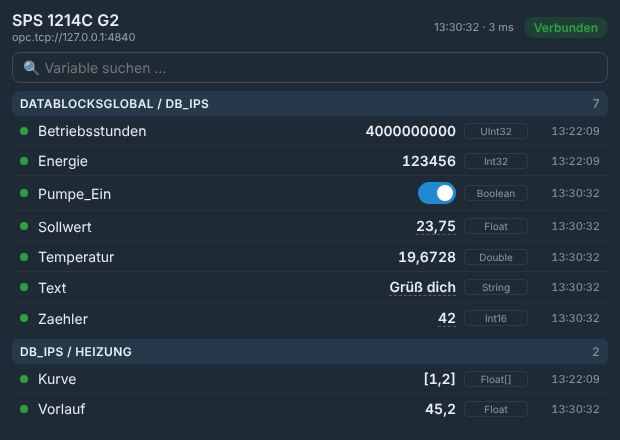

# OpenOPCUA – freier OPC-UA-Client für IP-Symcon

Freies IP-Symcon-Modul, das sich als **OPC-UA-Client** mit einem OPC-UA-Server verbindet – gebaut für die **SIMATIC S7-1200 G2** (funktioniert aber mit jedem OPC-UA-Server, z. B. S7-1500, CODESYS, Beckhoff). Damit braucht man die kostenpflichtige OPC-UA-Erweiterung von Symcon nicht.



## Funktionen

- **Server durchsuchen**: Adressraum wird ausgelesen, Variablen werden per Haken übernommen (mit Filter und „alle markieren“)
- **Automatische IPS-Variablen** mit dem passenden Typ; schreibbare Variablen bekommen eine Aktion (Schalter, Werteingabe)
- **Übersicht** gleich zweimal:
  - **Kachel für die Kachelvisu** mit allen Variablen, nach DB/Ordner gruppiert, Suchfeld, Status-Ampel und direkter Bedienung (Schalter für BOOL, Klick auf den Wert zum Ändern)
  - **Live-Liste im Konfigurationsformular** mit Wert, Typ, R/W, Status und Zeitstempel (wird laufend aktualisiert)
- **Security**: None, Basic256Sha256, Aes128Sha256RsaOaep, Aes256Sha256RsaPss (Sign / Sign & Encrypt), Anmeldung anonym oder mit Benutzer/Passwort. Das Client-Zertifikat wird automatisch erzeugt und ist 10 Jahre gültig.
- **Schnell**: Alle Werte gehen in einem einzigen Read-Request; die Session wird zwischen den Zyklen weiterverwendet. Gegen einen lokalen Testserver: ca. 5 ms pro Zyklus ohne Security, ca. 20 ms mit Basic256Sha256 (an der echten SPS etwas mehr).
- **Arrays** werden lesend als JSON-Text abgelegt
- Skriptfunktionen für beliebige NodeIds (`OOPCUA_ReadNode` / `OOPCUA_WriteNode`)

## Installation

1. In IP-Symcon die **Module Control** öffnen (Kerninstanzen → Modules)
2. Mit **+** folgende URL hinzufügen:
   `https://github.com/badfrog18/symcon-openopcua`
3. Instanz **„OpenOPCUA Client“** anlegen

Voraussetzung: IP-Symcon ab 7.1 (getestet mit 9.0). Die Bibliothek ist reines PHP und braucht nur `ext-openssl`, das in Symcon enthalten ist.

## Einrichtung S7-1200 G2 (TIA Portal V21)

1. **CPU-Eigenschaften → OPC UA → Server**: OPC-UA-Server aktivieren (Port 4840)
2. **Laufzeitlizenzen → OPC UA**: „SIMATIC OPC UA S7-1200 Basic“ eintragen. Die Lizenz ist bei Siemens zu erwerben und für den Produktivbetrieb vorgeschrieben.
3. **Security**: Für den Anfang die Policy „Keine Sicherheit“ bzw. *None* zulassen und den Gastzugang (anonym) erlauben. Später besser Basic256Sha256 mit Benutzer aus „Benutzer und Rollen“ verwenden.
4. Im Datenbaustein bei den gewünschten Variablen **„Erreichbar aus HMI/OPC UA/Web API“** anhaken
5. Laden, fertig

Bei Security ≠ None muss die SPS das Client-Zertifikat vertrauen. Entweder in TIA „Clientzertifikate zur Laufzeit automatisch akzeptieren“ aktivieren, oder das Zertifikat importieren. Es liegt nach dem ersten Verbindungsversuch unter
`http://<IPS-IP>:3777/user/OpenOPCUA_<InstanzID>.der`. Fingerprint und Link stehen in der Instanzkonfiguration.

## Bedienung

| Schritt | Wo |
|---|---|
| Endpoint eintragen, z. B. `opc.tcp://192.168.178.20:4840` | Verbindung |
| **Verbindung testen** | Aktionen |
| **Server durchsuchen** → Variablen anhaken → **Markierte übernehmen** | „Variablen vom Server auswählen“ |
| Namen anpassen, Variablen (de)aktivieren, Schreibrecht | Liste „Übernommene Variablen“ → Übernehmen |
| Übersicht ansehen | „Live-Übersicht“ oder Instanz in die Kachelvisu ziehen |

**Structs/UDTs**: Den Struct anhaken (blau markiert), dann werden alle seine Elemente übernommen, auch verschachtelte. Die Variablen heißen dann z. B. „Klima WZ - CMD_Mode“, damit gleichnamige Elemente mehrerer Structs unterscheidbar sind. In Kachel und Live-Übersicht ist der Struct die Gruppe. Mit der Option **„Structs als Kategorie im Objektbaum anlegen“** (Standard: an) wird jeder Struct zu einer Kategorie unter der Instanz, verschachtelte Structs zu Unterkategorien. Die Variablen heißen darin nur noch wie das Element (`CMD_Mode`) und bleiben bedienbar. Umbenennen geht in der Liste „Übernommene Variablen“, der neue Name wird auf die IPS-Variable übertragen.

### Typzuordnung

| OPC UA | IPS-Variable |
|---|---|
| Boolean | Boolean (`~Switch`) |
| SByte, Byte, Int16, UInt16, Int32 | Integer |
| UInt32, Int64, UInt64, Float, Double | Float (wegen des Wertebereichs) |
| DateTime | Integer (`~UnixTimestamp`) |
| String, LocalizedText, … | String |
| Arrays | String (JSON, nur lesend) |

Beim Schreiben wird der Wertebereich geprüft. Ein Int16 lehnt z. B. 99999 ab, bevor überhaupt etwas zur SPS geht.

## Skriptfunktionen

```php
OOPCUA_Update(int $InstanzID): bool                       // sofort alle Werte lesen
OOPCUA_ReadNode(int $InstanzID, string $NodeId): mixed     // beliebige Node lesen
OOPCUA_WriteNode(int $InstanzID, string $NodeId, $Wert): bool
OOPCUA_Browse(int $InstanzID): int                        // Server durchsuchen, liefert Anzahl
OOPCUA_AddNode(int $InstanzID, string $NodeId, string $Name): bool
OOPCUA_RenewCertificate(int $InstanzID): bool
OOPCUA_RemapNodes(int $InstanzID): string                // NodeIds über den Pfad neu zuordnen (nach Umbau der Serverschnittstelle)
OOPCUA_AdoptVariables(int $InstanzID, string $Map): string // bestehende Variablen übernehmen: {"VariablenID": "NodeId", …}

// Beispiel
OOPCUA_WriteNode(12345, 'ns=3;s="DB_IPS"."Pumpe_Ein"', true);
```

## Umstieg von einer anderen Anbindung (z. B. S7 PUT/GET)

Mit `OOPCUA_AdoptVariables` ziehen bestehende Variablen in die Instanz um und werden an eine Node gebunden. ID, Name, Profil, Archivdaten, Events und Links bleiben erhalten. Der Datentyp wird vorher geprüft. Skripte schreiben danach einfach mit `RequestAction(VariablenID, Wert)`.

Ändern sich nach einem Umbau der Serverschnittstelle die NodeIds, ordnet **„NodeIds über Pfad neu zuordnen“** die Nodes über ihren Pfad neu zu. Die IPS-Variablen bleiben dabei dieselben.

## Grenzen

- Polling statt Subscriptions: PHP-Module in Symcon laufen nicht als Dauerprozess. Realistisch sind Intervalle ab ca. 250 ms. Für sehr schnelle Signale besser die S7-Anbindung (PUT/GET) von Symcon verwenden.
- Das Server-Zertifikat wird nicht geprüft (im Heimnetz meist in Ordnung).
- Structs werden über ihre Elemente gelesen, nicht als ExtensionObject am Stück.

## Lizenzen

- Dieses Modul: MIT
- Mitgeliefert in `libs/`:
  - [php-opcua/opcua-client](https://github.com/php-opcua/opcua-client) v4.6.0, MIT. Eine kleine Anpassung: Null-Variant in DataValues wird toleriert (`Encoding/BinaryDecoder.php`, markiert mit „OpenOPCUA-Patch“).
  - psr/log, psr/simple-cache, psr/event-dispatcher (PHP-FIG), MIT
